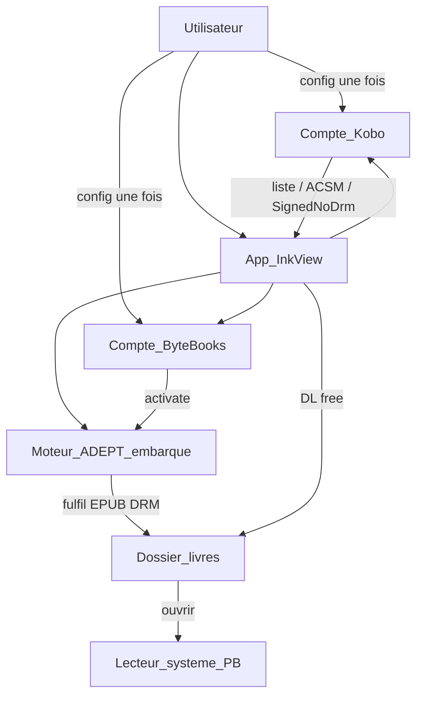

# Cahier des charges — PocketBook × Kobo

| | |
|---|---|
| **Projet** | Application native PocketBook pour accéder à une bibliothèque Kobo |
| **Version** | 0.5 |
| **Statut** | Brouillon |
| **Langue** | Français |
| **Appareil cible** | PocketBook Era (`PB700` / `u700`), firmware `6.10.3209` |
| **API Kobo (sonde)** | Auth/liste OK ; API appareil = souvent KDRM ; **export ACSM kobo.com dispo pour toute la biblio** (confirmé utilisateur) |
| **Architecture** | App autonome : Kobo (liste) + ACSM (téléchargement) + ByteBooks/ADEPT (fulfil) ; PB ouvre l’EPUB Adobe |

---

## 1. Contexte et problématique

Le matériel des liseuses PocketBook est jugé très satisfaisant (écran, autonomie, formats supportés). En revanche, l’écosystème logiciel ne propose pas d’équivalent au magasin et à la synchronisation de bibliothèque proposés par Kobo.

L’utilisateur possède déjà un compte Kobo et une bibliothèque de livres **achetés légalement**. L’**objectif métier** n’est pas de « supprimer des DRM », mais de **pouvoir lire ces livres sur sa PocketBook** — le DRM n’est qu’un obstacle technique éventuel sur le chemin de cet usage.

Besoins concrets :

- configurer **une fois** le compte Kobo **et** le compte ByteBooks (ADE) dans l’app ;
- consulter la liste des livres achetés ;
- télécharger / fulfiler automatiquement (l’app gère ACSM + ADEPT) ;
- ouvrir le livre (lecteur système PocketBook en priorité).

**Constat terrain** : le client ACSM / Adobe intégré à PocketBook échoue souvent avec les licences Kobo (`E_ADEPT_NO_FULFILLMENT_RESULT`). On **ne s’appuie plus** dessus. L’app embarque le parcours complet (auth Kobo, récupération ACSM / contenu, activation ADEPT ByteBooks, fulfilment) pour déposer un EPUB déjà prêt ; la liseuse n’a plus qu’à l’ouvrir.

**Position produit** : interopérabilité légitime (SignedNoDrm, ADEPT avec clés autorisées, export officiel Kobo). Pas de retrait de DRM ; le DRM Adobe est **honnoré** via un moteur ADEPT embarqué (même idée que Calibre/DeACSM + lecteur autorisé), pas contourné.

Ce document définit le périmètre, les exigences et les contraintes du MVP, ainsi que les études préalables obligatoires avant développement.

---

## 2. Objectifs et non-objectifs

### 2.1 Objectif métier

> Lire sur PocketBook les livres que l’utilisateur a **déjà achetés** chez Kobo, avec le moins de friction possible.

### 2.2 Objectifs techniques (MVP)

1. Configurer et persister **deux comptes** : Kobo (bibliothèque) + ByteBooks (identité ADEPT).
2. Afficher la liste des livres **achetés** (métadonnées : titre, auteur, couverture, état).
3. Pour un titre choisi : récupérer le contenu via Kobo (téléchargement direct ou ACSM), puis si besoin **fulfil ADEPT in-app** (moteur type libgourou) vers un EPUB Adobe DRM ou DRM-free.
4. Déposer le fichier dans le dossier livres et l’ouvrir avec le **lecteur système** PocketBook (appareil autorisé avec les mêmes credentials ADEPT / injection d’activation).
5. Mode lecture intégré en secours uniquement pour les EPUB déjà DRM-free.

### 2.3 Non-objectifs (hors MVP / hors projet)

| Hors scope | Motif |
|---|---|
| Achat / parcours magasin Kobo | Complexité et hors besoin immédiat |
| Synchronisation des annotations, surlignages, progression de lecture | Hors MVP |
| Application compagnon PC / téléphone | Décision produit : app uniquement sur PocketBook |
| Implémenter un contournement DRM (DeDRM, retrait KDRM, etc.) | Voir §5 — non fourni dans ce projet, même pour usage personnel |
| Distribution publique de l’application sans revue légale / ToS | Usage personnel cible ; publication = sujet séparé |
| Support des abonnements / prêts bibliothèque / audiolivres | Hors besoin initial |

---

## 3. Utilisateurs et scénarios

### 3.1 Utilisateur cible

Propriétaire d’une liseuse PocketBook disposant d’un compte Kobo avec des livres déjà achetés, connecté en Wi‑Fi.

### 3.2 Scénarios MVP

#### S0 — Première configuration (une fois)

1. L’utilisateur lance l’app depuis `/applications`.
2. Il saisit **Kobo** (e-mail / mot de passe ou flux auth retenu) **et** **ByteBooks** (e-mail / mot de passe ADE).
3. L’app active ADEPT localement (identité appareil) et stocke jetons + clés ADEPT hors accès utilisateur courant.
4. Optionnel mais cible : synchroniser / injecter l’activation vers le magasin Adobe du lecteur système pour que « Ouvrir » marche sans étape manuelle Settings → Adobe.

#### S1 — Liste

1. Au lancement (comptes déjà configurés), sync bibliothèque Kobo.
2. Liste scrollable e-ink : titre, auteur, couverture, état (à DL / prêt / incompatible).

#### S2 — Téléchargement + ouverture (cas nominal)

1. L’utilisateur choisit un livre non téléchargé.
2. L’app orchestre **tout** le pipeline (Kobo → fichier → éventuel fulfil ADEPT) sans autre saisie.
3. Fichier déposé dans le dossier livres ; bouton « Ouvrir » → lecteur système.

#### S3 — Titre via ACSM / Adobe (chemin principal hors SignedNoDrm)

1. L’app obtient un `.acsm` (export / access Kobo) ou une URL ADEPT.
2. Fulfilment **embarqué** (pas le client ACSM PocketBook) avec le compte ByteBooks déjà activé → EPUB Adobe DRM.
3. Ouverture lecteur système (mêmes clés ADEPT).

#### S4 — Livre DRM-free / `SignedNoDrm`

1. Téléchargement direct depuis l’API Kobo.
2. Ouverture lecteur système ou mode lecture intégré.

#### S5 — Livre KDRM sans export Adobe

1. L’API appareil ne donne que du **KDRM** et aucun ACSM / export Adobe n’est disponible pour le titre.
2. Pas de retrait DRM ; message « non compatible » + indication éventuelle d’export depuis kobo.com.
3. Le titre reste listé.

#### S6 — Erreurs

- Réseau, auth Kobo ou ByteBooks expirée, ACSM expiré, fulfil ADEPT en échec, disque plein : messages actionnables (reconnecter le compte concerné, retélécharger, libérer l’espace).

---

## 4. Exigences fonctionnelles

### 4.1 Authentification (double compte)

| ID | Exigence | Priorité |
|---|---|---|
| F-AUTH-01 | L’utilisateur peut connecter son compte **Kobo** depuis l’app | Must |
| F-AUTH-02 | L’utilisateur peut connecter son compte **ByteBooks** (identité ADEPT) depuis l’app | Must |
| F-AUTH-03 | Les deux jeux de credentials / jetons / clés ADEPT sont persistés localement (pas de resaisie à chaque lancement) | Must |
| F-AUTH-04 | Déconnexion séparée possible (Kobo seul, ByteBooks seul, ou les deux) | Must |
| F-AUTH-05 | Expiration / révocation → redemande uniquement le compte concerné | Must |
| F-AUTH-06 | Première config : wizard clair « Kobo puis ByteBooks » avant accès bibliothèque | Must |

*Flux Kobo (UserKey / device) : spike API. Flux ByteBooks : `adept_activate` embarqué (validé PC, à porter sur appareil).*

### 4.2 Bibliothèque

| ID | Exigence | Priorité |
|---|---|---|
| F-LIB-01 | Afficher la liste des livres achetés du compte | Must |
| F-LIB-02 | Afficher au minimum titre et auteur | Must |
| F-LIB-03 | Afficher la couverture lorsque l’API la fournit | Should |
| F-LIB-04 | Indiquer l’état : non téléchargé / téléchargé / incompatible DRM / erreur | Must |
| F-LIB-05 | Permettre un rafraîchissement manuel de la liste | Must |
| F-LIB-06 | Recherche / filtre local sur titre ou auteur | Could |

### 4.3 Téléchargement

| ID | Exigence | Priorité |
|---|---|---|
| F-DL-01 | Télécharger un livre sélectionné vers un chemin configurable (défaut : dossier livres PocketBook standard) | Must |
| F-DL-02 | Afficher progression / état pendant le téléchargement | Must |
| F-DL-03 | Ne pas écraser silencieusement un fichier existant (confirmation ou versioning simple) | Should |
| F-DL-04 | Supprimer un fichier téléchargé depuis l’app (fichier local uniquement) | Should |
| F-DL-05 | Déterminer et exposer le type DRM / format avant ou après accès contenu (`Adobe`, `KDRM`, `SignedNoDrm` / DRM-free, etc.) | Must |

### 4.4 Ouverture lecteur système

| ID | Exigence | Priorité |
|---|---|---|
| F-SYS-01 | Lancer le lecteur par défaut PocketBook sur un fichier téléchargé compatible | Must |
| F-SYS-02 | Si le lancement échoue, afficher une erreur et proposer le mode lecture intégré **uniquement** si le fichier est DRM-free | Must |

### 4.5 Mode lecture intégré

| ID | Exigence | Priorité |
|---|---|---|
| F-READ-01 | Ouvrir en lecture intégrée les EPUB (et idéalement PDF) **sans DRM** | Must |
| F-READ-02 | Pagination (page suivante / précédente), adaptée e-ink | Must |
| F-READ-03 | Ajustement taille de police | Should |
| F-READ-04 | Contraste adapté e-ink (pas de thème « glow » inutile) | Should |
| F-READ-05 | Mémoriser la position de lecture **locale** pour les livres ouverts en mode intégré | Could |
| F-READ-06 | **Interdiction** de déchiffrer ou contourner KDRM / Adobe DRM dans ce mode | Must |

### 4.6 Aide et erreurs

| ID | Exigence | Priorité |
|---|---|---|
| F-UX-01 | Écran d’aide : rôles des deux comptes, limitations KDRM, Wi‑Fi | Must |
| F-UX-02 | Messages d’erreur réseau, auth (Kobo vs ByteBooks), fulfil, stockage | Must |

---

## 5. Gestion du DRM

### 5.1 Intention vs contrainte

**Intention utilisateur** : lire des livres **achetés légalement** sur l’appareil choisi (PocketBook). Le DRM n’est pas la cible du projet ; c’est un frein possible à l’interopérabilité entre écosystèmes (Kobo → PocketBook).

**Contrainte projet** : le contournement technique des mesures de protection (retrait KDRM, outils type [DeDRM_tools](https://github.com/noDRM/DeDRM_tools/releases), etc.) reste **hors du périmètre de développement** de cette application. En pratique, le cadre européen / français sur les mesures techniques de protection restreint ce type de contournement, même pour un usage personnel. Ce dépôt et l’assistance associée ne fourniront ni code, ni procédure, ni intégration pour « enlever » un DRM.

Nous alignons donc le produit sur : **atteindre l’objectif de lecture** par tous les chemins **sans** contournement.

### 5.2 Types de protection — comportement app autonome

| Type | Comportement de l’app |
|---|---|
| **DRM-free** / `SignedNoDrm` | DL direct Kobo → fichier → ouvrir |
| **Adobe / ACSM** | Récupération ACSM (ou URL ADE) + **fulfil ADEPT embarqué** (ByteBooks) → EPUB DRM → ouvrir ; **pas** de client ACSM PocketBook ; **pas** de `adept_remove` |
| **KDRM** seul | Pas de retrait ; tenter export / ACSM officiel si exposé ; sinon message d’incompatibilité |

### 5.3 Stratégie « PocketBook n’a plus qu’à ouvrir » (ordre)

1. **SignedNoDrm** : pipeline le plus simple (MVP immédiat).
2. **ACSM → fulfil in-app** (prouvé sur PC avec libgourou 0.8.10 + ByteBooks) → EPUB Adobe DRM lié à l’activation de l’app.
3. **Autorisation lecteur système** : faire reconnaître cette activation ADEPT par le lecteur PocketBook (injection / activation partagée) pour que « Ouvrir » marche sans config manuelle Adobe.
4. **Mode lecture intégré** : secours DRM-free uniquement.
5. **KDRM sans ACSM** : limitation produit ; pas de contournement.

### 5.4 Références utiles (interopérabilité)

- Export de livres depuis le compte Kobo : [aide Kobo — télécharger pour un autre appareil](https://help.kobo.com/hc/en-us/articles/360019527954-Download-books-from-your-Kobo-account-to-export-to-another-device-or-app)
- Formats / Adobe DRM côté PocketBook : [FAQ PocketBook e-books](https://pocketbook.de/en/faq-ebooks-hoerbuchdownloads)

---

## 6. Exigences non fonctionnelles

| ID | Domaine | Exigence |
|---|---|---|
| NF-UI-01 | UI e-ink | Interface contrastée, textes lisibles, éviter animations inutiles et refresh excessifs |
| NF-UI-02 | Navigation | Compatible tactile et/ou boutons physiques selon le modèle |
| NF-NET-01 | Réseau | Fonctionne en Wi‑Fi ; timeouts et retry explicites |
| NF-SEC-01 | Sécurité | Credentials / jetons non loggés en clair ; stockage local restreint |
| NF-PERF-01 | Performance | Liste bibliothèque utilisable jusqu’à plusieurs centaines de titres (pagination ou chargement progressif si besoin) |
| NF-LOG-01 | Debug | Journal local activable pour diagnostiquer auth / téléchargements (sans secrets) |
| NF-LEG-01 | Cadre | Cible = usage personnel ; dépendance à une API Kobo **non officielle** assumée et documentée |
| NF-PORT-01 | Portabilité | Build ciblant le firmware / SDK correspondant au modèle de l’utilisateur (à confirmer en spike) |

---

## 7. Architecture cible (MVP) — app autonome

### 7.1 Vue d’ensemble

Principe : **tout le métier est dans l’app**. Le firmware PocketBook (ACSM cassé pour Kobo) n’est utilisé qu’en **lecteur de fichier** une fois le livre prêt.

### 7.2 Composants logiques

| Composant | Rôle |
|---|---|
| **UI InkView** | Wizard double compte, bibliothèque, progression, aide |
| **Client Kobo** | Auth, sync, métadonnées, URLs / ACSM |
| **Client ByteBooks / ADEPT** | `adept_activate` + persistance `.adept` (clés appareil) |
| **Fulfilleur ACSM** | Port de libgourou / équivalent : ACSM → EPUB Adobe DRM **sans** retrait |
| **Pont lecteur système** | Déposer le fichier + faire reconnaître l’activation ADEPT par le reader stock (spike dédié) |
| **Gestionnaire fichiers** | Inventaire local, états DL |
| **Lecteur intégré** | Secours EPUB DRM-free uniquement |
| **Store secrets** | Credentials Kobo + ByteBooks + clés ADEPT |

### 7.3 Stack technique prévue

- **Langage** : C/C++
- **UI / OS** : InkView
- **SDK** : **6.10 / B288** — voir [`docs/spikes/pocketbook-sdk.md`](docs/spikes/pocketbook-sdk.md)
- **ADEPT** : logique type [libgourou](https://blog.soutade.fr/post/2021/07/libgourou-a-free-adept-protocol-implementation.html) (spike PC **GO** : [`tools/acsm_fulfill/`](tools/acsm_fulfill/))
- **Déploiement** : `.app` dans `/applications`
- **Non utilisé** : client ACSM / Adobe Settings de PocketBook pour le fulfilment Kobo

### 7.4 Intégration Kobo

API non officielle (communautaire) : auth device, `library/sync`, `content_access_book`, export ACSM quand exposé. Risque ToS / rupture assumé — cartographie dans [`docs/spikes/kobo-api.md`](docs/spikes/kobo-api.md).

### 7.5 Décisions figées

| Décision | Choix |
|---|---|
| Plateforme MVP | Uniquement PocketBook (pas d’app compagnon) |
| Autonomie | App embarque Kobo **et** ByteBooks + moteur ADEPT |
| Rôle firmware PB | Ouvrir le fichier final seulement (pas le fulfil ACSM) |
| Périmètre contenu | Bibliothèque achetée |
| DRM | Honorer ADEPT (clés ByteBooks) ; **pas** de DeDRM / retrait KDRM |
| Lecture intégrée | Secours DRM-free |

---

## 8. Études préalables (spikes) — obligatoires avant le code métier

Aucun développement des écrans métier (liste, téléchargement produit) tant que les spikes suivants n’ont pas un résultat documenté (recommandé : `docs/spikes/`).

### 8.1 Checklist spike PocketBook / SDK

- [ ] Confirmer le **modèle exact** de la liseuse et la **version de firmware**
- [ ] Identifier la **branche SDK** compatible ([SDK_6.3.0](https://github.com/pocketbook/SDK_6.3.0))
- [ ] Builder et déployer un **hello world** `.app` dans `/applications` (ex. dérivé de [pocketbook-sdk-sample](https://github.com/kotborealis/pocketbook-sdk-sample))
- [ ] Vérifier Wi‑Fi / HTTPS depuis une app InkView (requête test)
- [ ] Déterminer le **chemin de stockage** livres recommandé sur le modèle
- [ ] Vérifier **comment ouvrir un EPUB** depuis l’app (API InkView / lancement lecteur stock / association de fichier)
- [ ] Tester ouverture d’un **EPUB Adobe DRM** fulfilé (ex. `book.drm` du spike) sur la PB
- [ ] Spike **pont ADEPT** : faire accepter l’activation ByteBooks de l’app par le lecteur stock
- [ ] Tester un **EPUB DRM-free** via lecteur système

### 8.2 Checklist spike API Kobo

- [ ] Documenter le flux d’**authentification** retenu (étapes, headers, secrets)
- [ ] Cartographier les endpoints : auth, initialization, library sync, metadata, content access / download
- [ ] Pour un échantillon de livres du compte réel : noter `DRMType`, `UrlFormat`, présence de clés de contenu
- [ ] Mesurer le taux de titres **Adobe / DRM-free / KDRM** sur la bibliothèque cible
- [ ] Vérifier le comportement des livres **archivés**
- [ ] Évaluer la stabilité et les risques ToS (go / no-go écrit)
- [ ] Si KDRM majoritaire : documenter un parcours de repli via **export officiel** compte Kobo (hors API appareil) — faisabilité technique depuis la liseuse ou limitation acceptée

### 8.3 Livrables des spikes

1. `docs/spikes/pocketbook-sdk.md` — modèle, SDK, hello world, ouverture fichier, tests DRM Adobe / free  
2. `docs/spikes/kobo-api.md` — auth, endpoints, matrice DRM observée, go / no-go  
3. Mise à jour éventuelle de ce cahier des charges (§4 auth, §5, roadmap) si les spikes imposent un ajustement de périmètre

---

## 9. Roadmap MVP

| Milestone | Contenu | Critère de fin |
|---|---|---|
| **M1 — Spikes** | SDK + API Kobo + ADEPT PC (§8) | Docs + go/no-go (ADEPT PC = **GO**) |
| **M2 — Comptes + liste** | Wizard Kobo + ByteBooks, sync bibliothèque | Double login OK, liste sur appareil |
| **M3 — Pipeline DL** | SignedNoDrm + ACSM fulfil embarqué + ouvrir stock | Au moins un free et un Adobe DRM ouverts |
| **M4 — Pont ADEPT ↔ lecteur PB** | Activation partagée / injection pour ouverture native | Plus de config Adobe manuelle |
| **M5 — Polish** | UX e-ink, aide, KDRM, logs | Scénarios S0–S6 |

---

## 10. Risques et mitigations

| Risque | Impact | Mitigation |
|---|---|---|
| API Kobo non officielle cassée ou bloquée | Bloquant | Spike tôt ; isolation du client API ; surveillance |
| Majorité des titres en **KDRM** uniquement | Lecture impossible via l’app sans contournement (hors scope) | Matrice DRM en M1 ; message clair ; maximiser export Adobe / DRM-free officiel |
| Client ACSM PocketBook inutilisable avec Kobo | Fulfil échoue sur firmware | **Mitigé** : fulfil embarqué (décision archi v0.5) |
| Lecteur stock n’accepte pas les clés ADEPT de l’app | EPUB DRM non ouvrable | Spike pont ADEPT ; fallback procédure manuelle ByteBooks une fois |
| ByteBooks / ADE down | Pas de fulfil Adobe | Message clair ; SignedNoDrm reste OK |
| SDK / firmware mal matchés | App ne démarre pas | Spike hello world sur l’appareil réel |
| Sideload `.app` limité selon firmware | Installation impossible | Vérifier politique / méthode d’install sur le modèle |
| Cadre légal / CGU Kobo | Risque usage | Usage personnel ; pas de contournement DRM ; pas de redistribution des livres |
| HTTPS / certificats sur liseuse | Auth ou DL cassés | Test réseau dès M1 |

---

## 11. Critères d’acceptation globaux (MVP)

Le MVP est accepté si, sur la PocketBook cible :

1. L’utilisateur configure **Kobo + ByteBooks** une fois et voit sa bibliothèque.
2. Un livre **SignedNoDrm** est téléchargé et ouvert dans le lecteur système **sans** autre outil.
3. Un livre via **ACSM** est fulfilé **par l’app** (pas le client ACSM PB) et ouvert dans le lecteur système.
4. Un livre **KDRM** sans export Adobe affiche une limitation **sans** retrait de DRM.
5. Aucun DeDRM / retrait KDRM dans le code ni la doc projet.

---

## 12. Glossaire

| Terme | Définition |
|---|---|
| **InkView** | Framework UI / API applicative des liseuses PocketBook (Linux) |
| **Adobe DRM / ADEPT** | Protection Adobe ; PocketBook peut lire ces fichiers si autorisée |
| **ACSM** | Fichier de licence Adobe pointant vers le contenu protégé |
| **KDRM** | DRM propriétaire Kobo ; non supporté par le lecteur PocketBook |
| **KEPUB** | Variante EPUB utilisée par Kobo |
| **UserKey / DeviceId** | Éléments d’auth appareil décrits dans les recherches communautaires sur l’API Kobo |

---

## 13. Historique du document

| Version | Date | Auteur | Changements |
|---|---|---|---|
| 0.1 | 2026-10-28 | Projet pocketbook-kobo-shop | Création initiale du cahier des charges |
| 0.2 | 2026-10-28 | Projet pocketbook-kobo-shop | Clarification : objectif = lecture des livres achetés ; DRM = frein, pas but ; contournement hors développement |
| 0.3 | 2026-10-28 | Projet pocketbook-kobo-shop | Appareil cible : Era PB700, firmware u700.6.10.3209 ; SDK 6.10 B288 |
| 0.4 | 2026-10-28 | Projet pocketbook-kobo-shop | Sonde Kobo : 44 SignedNoDrm / 159 KDRM / 0 AdobeDrm → MVP partiel GO |
| 0.5 | 2026-10-28 | Projet pocketbook-kobo-shop | Archi autonome : Kobo + ByteBooks in-app, fulfil ADEPT embarqué ; PB = ouvrir seulement |
