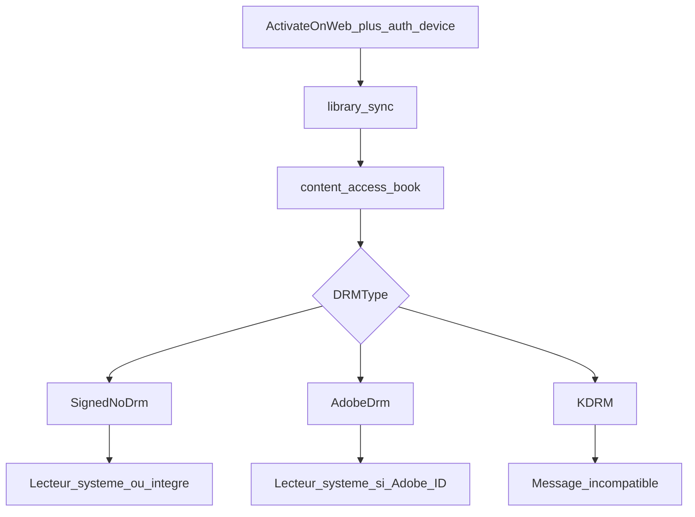

# Spike — API Kobo (bibliothèque achetée)

| | |
|---|---|
| **Date** | 2026-10-28 |
| **Statut** | **Mesure compte réel OK** — verdict ci-dessous |
| **Objectif** | Savoir si on peut, depuis une app PocketBook, lister et télécharger des livres Kobo **lisibles** sans contournement DRM |

## Verdict (après sonde compte)

### Chiffres (224 titres sondés, 6 archivés ignorés)

| `DRMType` | Livres | % | Lisible PocketBook sans contournement ? |
|---|---:|---:|---|
| `SignedNoDrm` | **44** | 19,6 % | **Oui** (surtout KEPUB / quelques EPUB3) |
| `KDRM` | **159** | 71,0 % | **Non** (hors scope projet) |
| `None` | **21** | 9,4 % | Surtout **échantillons** (`EPUB_SAMPLE` / `EPUB3_SAMPLE`) — pas des livres complets utiles |
| `AdobeDrm` | **0** | 0 % | Absent via l’API store sur ce compte |

Combinaisons exclusives (aucun livre mixte SignedNoDrm+KDRM). Auth + sync : **OK** (310 entrées sync → 230 entitlements).

### Décision

| Périmètre | Verdict |
|---|---|
| Auth + liste bibliothèque via API store | **GO** |
| Téléchargement + lecture des **`SignedNoDrm`** (~44 titres) | **GO MVP** |
| Lecture des **`KDRM`** (~159 titres) via retrait DRM | **NO-GO** (hors projet) |
| Couvrir *toute* la bibliothèque uniquement via API store | **NO-GO** (71 % KDRM) |
| Suite pour les KDRM | **Chemin B obligatoire** : export ACSM kobo.com (confirmé dispo pour *toute* la biblio utilisateur) → fulfil ADEPT ByteBooks |

**MVP recommandé** : liste via API store ; DL **`SignedNoDrm` (Android)** sinon **ACSM via `DisplayProfile=Desktop`** (export Adobe, même titres souvent `KDRM` en Android) → fulfil ByteBooks. Pas de DeDRM.

### ACSM via store API (spike 2026-10-28)

| `DisplayProfile` | Titre typiquement `KDRM` en Android |
|---|---|
| `Android` | `KDRM` / KEPUB (appareil) |
| **`Desktop`** | **`AdobeDrm` / EPUB** → URL `https://acs4.kobo.com/fulfillment/URLLink.acsm?…` |

- Télécharger le GBLink **sans réécrire la query** (`+` / `%xx`) sinon `E_URLLINK_AUTH`.
- `requests` (Python) réencode → erreur ; `curl -g` / libcurl `CURLOPT_PATH_AS_IS` → `fulfillmentToken` OK.
- Couverture Desktop ≈ majorité des KDRM ; quelques titres restent sans ACSM côté API (repli kobo.com).

**Risques transverses** : API non officielle ; CGU ; rupture possible.

---

## 1. Deux chemins distincts (ne pas confondre)

### A. API appareil / store (`storeapi.kobo.com`) — cible app PocketBook

Flux que suivent les liseuses Kobo (et les clients open-source type [kobo-book-downloader](https://github.com/TnS-hun/kobo-book-downloader)) :

1. Auth appareil → Bearer token  
2. `initialization` → URLs des ressources  
3. `library_sync` → bibliothèque  
4. `…/products/books/{id}/access` → URLs de téléchargement + type DRM  

Formats typiques côté API : **KEPUB / EPUB3** avec **`KDRM`** ou **`SignedNoDrm`**. Des forks mentionnent aussi **`AdobeDrm`**.

### B. Export web officiel (compte kobo.com) — interopérabilité Adobe

Documenté par Kobo : [télécharger pour un autre appareil](https://help.kobo.com/hc/en-us/articles/360019527954-Download-books-from-your-Kobo-account-to-export-to-another-device-or-app).

- Produit un EPUB/PDF **Adobe DRM** (souvent via ACSM / ADE) ou **DRM-free**  
- Destiné explicitement aux appareils non-Kobo  
- PocketBook lit Adobe DRM si l’appareil est autorisé  

Ce flux **n’est pas** le même endpoint que `content_access_book`. Pour le MVP native PocketBook, il faudra soit :

- s’appuyer surtout sur (A) et accepter les titres non-KDRM,  
- soit **assister** (B) plus tard (navigateur / ACSM) — hors premier jet si trop lourd.

---

## 2. Authentification (chemin A)

Références : notes Calibre-Web [`kobo_auth.py`](https://github.com/janeczku/calibre-web/blob/master/cps/kobo_auth.py), implémentation [TnS-hun/Kobo.py](https://github.com/TnS-hun/kobo-book-downloader/blob/master/kobo-book-downloader/Kobo.py).

### 2.1 ActivateOnWeb (login utilisateur)

1. Générer un `DeviceId` (hex) + `SerialNumber` locaux  
2. `GET https://auth.kobobooks.com/ActivateOnWeb?…` (platform / device / app version)  
3. Extraire un **code** + URL de poll  
4. L’utilisateur ouvre `https://www.kobo.com/activate`, entre le code, se connecte  
5. Poll jusqu’à `Status=Complete` → `userId` + **`userKey`** (dans `RedirectUrl` type `kobo://UserAuthenticated?…`)

**UX PocketBook** : afficher le code + URL ; l’utilisateur active depuis téléphone / PC. Pas besoin de saisir le mot de passe Kobo dans l’app (bon pour e-ink et sécurité).

### 2.2 Auth device → Bearer

`POST https://storeapi.kobo.com/v1/auth/device`

Corps typique :

- `AffiliateName`, `AppVersion`, `ClientKey` (PlatformId en base64), `DeviceId`, `PlatformId`, `SerialNumber`  
- `UserKey` (après activation)

Réponse : `AccessToken`, `RefreshToken`, `TokenType=Bearer`, éventuellement `UserKey` mis à jour.

### 2.3 Refresh

`POST https://storeapi.kobo.com/v1/auth/refresh` avec Bearer + `RefreshToken`.

### 2.4 Remarques sécurité

- `DeviceId` + `UserKey` agissent comme un jeton durable (changement de mot de passe Kobo **ne les invalide pas** forcément — point connu côté recherches communautaires).  
- Sur PocketBook : stocker chiffré / permissions restreintes ; permettre déconnexion = effacement local.

---

## 3. Endpoints utiles (après `initialization`)

`GET https://storeapi.kobo.com/v1/initialization` → objet `Resources` avec des URL templates, notamment :

| Clé ressource | Rôle typique |
|---|---|
| `library_sync` | Liste / sync bibliothèque (`GET`, pagination via headers `x-kobo-sync` / `x-kobo-synctoken`) |
| `book` | Métadonnées produit `…/products/books/{ProductId}` |
| `content_access_book` | Accès téléchargement `…/products/books/{ProductId}/access?DisplayProfile=…` |
| `device_auth` / `device_refresh` | Auth (souvent aussi en URL fixe `/v1/auth/device`) |

Headers courants : `Authorization: Bearer …`, User-Agent type client Kobo.

`DisplayProfile` vu dans les clients : ex. `Android` (peut influencer les URLs proposées).

---

## 4. Matrice DRM / formats (chemin A)

D’après les clients open-source inspectés :

| `DRMType` | Formats vus | Lisible PocketBook **sans** contournement ? | Action app |
|---|---|---|---|
| `SignedNoDrm` | EPUB3, KEPUB, … | **Oui** (fichier EPUB) | Télécharger → lecteur système / mode intégré |
| `AdobeDrm` | (si présent dans `ContentUrls`) | **Oui si** Adobe ID autorisé sur la liseuse | Télécharger → lecteur système |
| `KDRM` | EPUB3 / KEPUB | **Non** (DRM proprio Kobo) | Marquer incompatible ; pas de retrait DRM |

`ContentKeys` : clés associées surtout au flux KDRM. **Hors scope** de ce projet (pas de déchiffrement KDRM).

Livres **archivés** : `ContentUrls` / `ContentKeys` souvent vides → message « désarchiver sur kobo.com ».

---

## 5. Implications produit PocketBook × Kobo



**Bloquant réel** : proportion de `KDRM` sur la bibliothèque utilisateur.

- Si beaucoup de `SignedNoDrm` / `AdobeDrm` → MVP utile.  
- Si quasi-tout en `KDRM` → l’API store seule **ne suffit pas** au besoin « lire mes livres » sans contournement ; il faudrait alors explorer l’assistance à l’**export web Adobe** (chemin B), plus complexe sur liseuse.

---

## 6. Sonde compte — exécutée

Script : [`tools/kobo_probe/kobo_probe.py`](../../tools/kobo_probe/kobo_probe.py)  
Matrice : `docs/spikes/kobo-drm-matrix.json` (gitignored — données compte)

Relancer :

```bash
cd /home/gilles/pocketbook-kobo-shop
source .venv/bin/activate
# supprimer kobo-probe-state.json pour forcer une nouvelle activation
python3 tools/kobo_probe/kobo_probe.py
```

---

## 7. Critères (rappel) vs résultat

| Critère initial | Résultat réel |
|---|---|
| Auth / sync | OK |
| Part lisible sans contournement | **~20 %** (`SignedNoDrm`) — sous le seuil indicatif 30 %, mais **volume utile non nul (44 livres)** → MVP partiel **GO** |
| Adobe via store API | **0** sur ce compte |
| KDRM majoritaire | **Oui (71 %)** → chemin B reste pertinent pour la suite |

---

## 7bis. ACSM Kobo + PocketBook / test PC (2026-10-28)

- Ouverture **native** d’un `.acsm` Kobo sur PocketBook → `E_ADEPT_NO_FULFILLMENT_RESULT` (problème connu Kobo ↔ client Adobe liseuse).
- Compte [ByteBooks](https://dtsbytebooks.com/) = identifiants ADE, **pas** accès au RMSDK commercial.
- Test protocolaire open-source (fulfilment **sans** retrait DRM) : [`tools/acsm_fulfill/`](../../tools/acsm_fulfill/) — **libgourou AppImage 0.8.10** (`activate` puis `download`). L’image Docker échoue souvent en SSL (`0x500b`, CA manquants).

### Résultat PC — GO

| Étape | Résultat |
|---|---|
| `adept_activate` (ByteBooks) | OK → `tools/acsm_fulfill/adept/` |
| `acsmdownloader` sur `ascm_exemple/test.acsm` (Kobo, `acs4.kobo.com`) | OK → `tools/acsm_fulfill/out/book.drm` (~6 Mo, type EPUB) |
| Retrait DRM | **non** (volontaire) |

**Conclusion** : le protocole ADEPT Kobo fonctionne hors PocketBook. Le blocage est côté **client ACSM de la liseuse**, pas côté licence Kobo.

**Décision produit (CDC v0.5)** : l’app PocketBook est **autonome** — comptes **Kobo + ByteBooks**, moteur ADEPT embarqué (fulfil), dépôt d’un EPUB prêt ; le firmware PB ne fait qu’**ouvrir** le fichier. Prochain spike : ouverture de `book.drm` sur l’Era + pont d’activation ADEPT vers le lecteur stock.

---

## 8. Travail d’implémentation futur (MVP)

Module C/C++ ou couche réseau InkView :

- client HTTP HTTPS (certificats PocketBook)  
- ActivateOnWeb UI (code + poll)  
- persistance tokens  
- sync + cache métadonnées  
- download vers `/mnt/ext1/…`  
- branchement DRM selon matrice  

D’abord : **résultats de la sonde**.

---

## 9. Références

- [TnS-hun/kobo-book-downloader — Kobo.py](https://github.com/TnS-hun/kobo-book-downloader/blob/master/kobo-book-downloader/Kobo.py) (auth, sync, access ; *contient aussi un retireur DRM — non utilisé ici*)  
- [Calibre-Web kobo_auth notes](https://github.com/janeczku/calibre-web/blob/master/cps/kobo_auth.py)  
- [Aide Kobo — export autre appareil](https://help.kobo.com/hc/en-us/articles/360019527954-Download-books-from-your-Kobo-account-to-export-to-another-device-or-app)  
- CDC projet : [`CAHIER_DES_CHARGES.md`](../../CAHIER_DES_CHARGES.md) §5  
